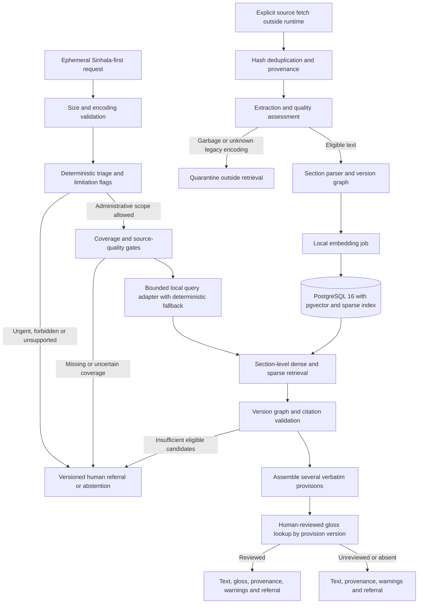

# Architecture

Status is T7, 19 November 2026. Intake, version evidence, source-anchored retrieval,
triage, extractive assembly, a bounded answer API and Sinhala-first UI are implemented.
The endpoint uses `SafetyNavigator`; default navigation and unreviewed copy stay
closed. Actual gloss, UI and safety-copy review remain pending;
referral publisher listings are checked, with regional phones and two specialist
urgent routes withheld pending evidence/review. The diagram includes planned components.
Research-only bounded model contracts and a pinned process adapter are implemented
separately; no model is wired into the answer path. See `model-contract.md` for
the measured/unmeasured boundary, failure fallbacks and laptop instructions.
T7 isolates the default-closed app and its separate source database with no
container networking and Unix sockets. Synthetic encrypted recovery and namespace
egress checks were executed. Laptop gateway/OS controls remain unverified;
operations/governance guides distinguish those boundaries explicitly.

## Two targets

TARGET A is this container. All deterministic parsing, provenance, triage,
assembly, API, templates and CI use interfaces with fake/stub adapters and
synthetic fixtures, with no network or GPU required by the test suite.

TARGET B is the Xubuntu laptop, with 16 GB RAM, a 4 GB GPU and a 1 TB SSD.
Full corpus ingestion, embeddings, bounded inference, OCR at scale and measured
integration runs belong there. No service is installed on the live home-lab
server and no production application or data is used.

## Request and ingestion paths

Product triage executes before retrieval or any model call. Unsupported/malformed inputs
stop safely. A model's intent classification cannot lower a deterministic risk
classification or expand the allowed domain. Every urgent path returns human
help without legal analysis. T4/T6 spies prove no downstream/model invocation for
the tested urgent and malformed scenarios; language coverage is not exhaustive.

The launch gate is a release evidence model. It does not classify user requests.
Default navigation remains disabled. T6's private harness can measure low-risk
Tamil/Singlish tasks without changing product triage or the default closed API.

## Data and version contracts

| Entity | Required evidence and constraints |
| --- | --- |
| Source document | Canonical URL, acquisition time, publisher, language, content hash, upstream revision, licence evidence, extraction method, quality score/reasons |
| Instrument | Instrument type, number, year, original source and stable internal identifier |
| Provision version | Instrument link, section identifier, verbatim text, language, source page/offset anchors, text hash and verification state |
| Version edge | Explicit amends, repeals or commences relationship, supporting source, effective-date evidence, confidence/review state |
| Retrieval candidate | Provision-version link, dense/sparse score provenance, quality eligibility, citation and version validation result |
| Gloss | Provision-version key, language, text, review status, reviewer role, review date and text hash binding |
| Referral | Organisation/route, languages, region, source, verification date, expiry/recheck status and consent requirements |

Unknown amendment, commencement or consolidation state remains explicit. A
retrieved historical provision is never described as current merely because it
has a recent acquisition date. Gloss review expires when its bound provision
version changes. Distinguish acquisition age, legal effective dates and review
dates. Do not compute user-specific legal deadlines.

Every displayed provision has instrument type, number, year, section, language
version, source URL, retrieval date, amendment and commencement status, plus a
staleness warning. Missing mandatory evidence prevents display. The user sees
multiple eligible candidate provisions. If fewer than two survive the gates,
abstain and refer. Retrieving 15 candidates is an initial experiment for T3,
with thresholds determined by legal-text evaluation in T8.

The brief's government-service retrieval benchmark informs experiments only.
It does not validate statutory retrieval. No legal corpus has been ingested or
measured during T1.

## Adapter boundaries

| Boundary | Deterministic side | Laptop side |
| --- | --- | --- |
| Corpus source | Tiny invented document fixture and content hash | Explicit fetch, source inventory and licence verification |
| Extraction/OCR | Quality policy, parser and quarantine reasons | Tesseract Sinhala and measured fallback engine |
| Embedding | Deterministic fake vectors for ranking tests | BGE-M3 with measured CPU/quantised/ONNX backend |
| Search storage | Fake adapter for unit tests | PostgreSQL/pgvector migration integration tests |
| Bounded model | Strict task schemas, validation and fixed fallbacks | Local 4B-class Q4 inference with measured Sinhala quality |
| Referral/gloss stores | Versioned synthetic directory and review states | Primary-source contact checks and attorney review |

These are architectural boundaries, with implementation introduced in the
appropriate turns. T1 creates no empty service abstractions or model downloads.

## Resources and operation

Use one datastore and local processes. PostgreSQL's T1 development container is
capped at 1 GiB RAM and one CPU. CI does not start it. Aim to keep the eventual
application and database within a 4 GiB RAM budget, leaving room for the OS, OCR
and models, and measure the actual high-water marks before adopting a backend.
Avoid concurrent embedding and instruct-model GPU residency until measurement
proves that they fit. A 4 GB GPU is a constraint to test, not evidence of fit.

Installation downloads are explicit. The T7 core services have no network
interface beyond namespace loopback; a proposed separate host gateway binds to
laptop loopback and needs independent host-policy verification. The tested
synthetic path has safe logs, ephemeral state, retention controls and encrypted
backup/restore. No paid runtime APIs, hosted vectors or production systems
are part of this design. Basic use remains free unless a future reviewed change
satisfies the stated institutional delivery condition and budget.

## Launch gate

No public deployment to real users until an attorney-at-law has reviewed the
taxonomy, gloss library and escalation rules, the DPIA is complete, golden-set
thresholds pass, the corpus gap register is closed for every domain offered,
and either an institutional partner is engaged or the service is free, clearly
non-authoritative and referral-first. Private prototype until then.

T1 evidence is development infrastructure and synthetic tests. It establishes
neither legal accuracy nor deployment readiness.
