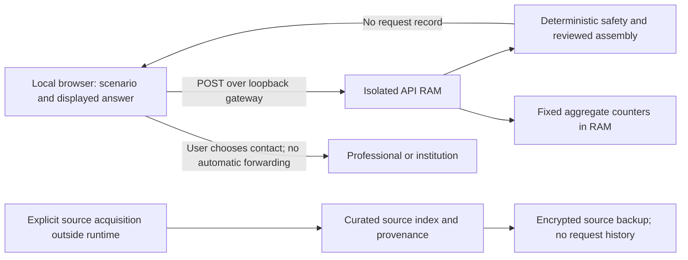

# Data protection impact assessment — draft for counsel

19 November 2026. Status: **INCOMPLETE / UNAPPROVED**. Engineering owner is the
maintainer; actual controller, reviewer, DPO decision and acceptance authority
are UNASSIGNED. This skeleton is mapped to the inspected PDPA text in
`pdpa-verification.md`; applicable commencement/rules need qualified review.
Do not set the DPIA release flag from the existence of this document.

## Purpose, necessity and boundary

Proposed purpose: free, non-authoritative procedural legal-information navigation
and user-initiated referral. The current private prototype accepts invented
scenarios only; navigation/review gates remain closed. No account, case-management
system, profiling history, document upload or automated institutional intake is
implemented. Facts are optional scenario text; users should avoid names, ID
numbers, addresses and third-party details. Minimisation instructions do not
guarantee people will omit sensitive data.

The hypothetical real service may receive allegations, health/distress/violence,
family/employment facts and information about children or third parties. These
risks require explicit assessment of categories, lawful basis, special-category
conditions and safeguards. No basis or exemption has been selected by engineering.
Public judgment/corpus content is a separate processing inventory with source
rights/privacy questions; public availability is not an automatic exemption.

Core containers have no network interface beyond their own loopback and use Unix
sockets. The laptop gateway/OS/browser remain separate trust boundaries. Cloud
synthetic namespace tests do not verify the maintainer's laptop, browser extensions,
swap, disk encryption, backups outside this tool or every possible side channel.

## Processing inventory and proportionality

| Flow | Data / recipients | Necessity and retention |
| --- | --- | --- |
| Browser form/rendering | Scenario and source/professional information; local user | No browser storage/cookies; Clear/page exit/five-minute inactivity clear DOM. Browser/OS memory is not cryptographically erased. |
| API/triage/assembly | Scenario and transient decisions; local process only | Request-memory only; no durable session/account/query table. Request completion releases application references, not a guaranteed byte-level wipe. |
| Bounded model research | Invented measurement strings; separate local tool | Not connected to product API; no real users, raw replies/prompts or external API. |
| Metrics | Fixed route/status/bucket counts; local operator | Process lifetime; optional Prometheus retention one hour; no IDs, content, urgency/domain/language labels. Low-volume timing/count disclosure still needs review. |
| Corpus/index | Public source artefacts/provenance, potentially judgment identifiers | Read-only evidence in runtime design; separate licensed/minimised ingestion. Retention decisions for archival evidence need counsel; never use a query-history backup. |
| Backup/drill | Encrypted invented/source rows; operator recovery | Synthetic proof only, capped at 16 MiB; owned reports/backups expire in seven days when scheduled cleanup runs. Keys kept separately from backup directory. |
| Referral | Published contact metadata; user's separate interaction | No automatic message, referral payload, consent token or transfer exists. Future integration needs a fresh assessment and agreement. |

## Threats, controls and residual risk

| Risk | Initial impact | Implemented evidence / proposed control | Residual / release decision |
| --- | --- | --- | --- |
| Scenario leaves machine/country | Severe | Network-none API/DB; tested TCP/UDP/IPv6/DNS; stdin model prompts; no hosted runtime APIs | Laptop gateway BPF policy and host/browser paths UNVERIFIED; no live users |
| Logs/metrics reveal identity or distress | Severe | Formatter ignores messages/args/exceptions/extras; Docker logs off; fixed labels; canary checks | Host launchers, support workflows and optional metrics storage require operator audit |
| Browser/back navigation retains facts | High | No storage; Clear abort/epoch protection, pagehide and five-minute clearing | Browser heap, extensions, screenshots, shoulder-surfing and OS restore need local safeguards |
| Legal/model error harms a vulnerable person | Severe | Deterministic escalation first, no model legal prose, reviewed copy/gloss/version gates | Reviews, real-source coverage and language/legal evaluation incomplete; public gate closed |
| Retention/deletion claim overstates erasure | High | No query persistence; scoped timestamp cleanup; preview/apply tests | Swap/SSD snapshots cannot be securely wiped by unlink; require encrypted local storage and documented operator verification |
| Backup loss or theft | High | GnuPG authenticated encryption, corruption rejection, actual restore/hash comparison | Recovery-key custody, offline copy and real corpus scale UNVERIFIED |
| Source/corpus misuse | High | Provenance/quality gates; official conflicts govern; no real judgments bundled | Rights, minimisation, missing versions and Supreme Court access unresolved |
| Institutional or household-role assumptions | High | No outreach/automatic forwarding or claimed partnership | Controller/processor/joint roles, lawful basis and DPO duty require counsel |

## Required decisions and acceptance

Counsel/operator must name controller/contact and accountable approver, choose
lawful bases/conditions, assess necessity of each fact, decide DPO designation,
review automated-decision implications, minors/third-party handling, rights and
complaint routes, institutional agreements and current final rules/orders. Have
Sinhala reviewers review the actual notice and UI, not just this English draft.

Run the isolated drill on TARGET B, inspect the gateway's actual BPF/loopback
restrictions, verify encrypted disk/swap and backup-key recovery, complete
language/legal golden-set review and close offered-domain corpus gaps. Record
reviewed version, evidence reference, date and residual-risk acceptance outside
Git; reference non-identifying evidence here. Reassess on new model, intake,
logging, source processing, deployment, operator or retention changes, as well
as the section 24 methodology/technology/process change mapping. None of these
acceptances has occurred in T7.
